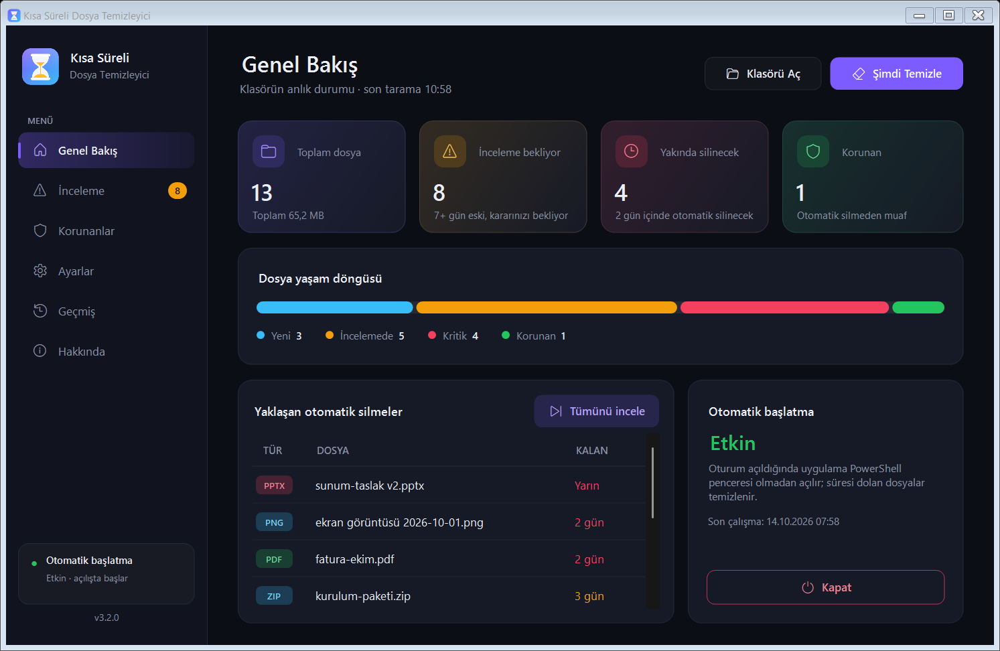
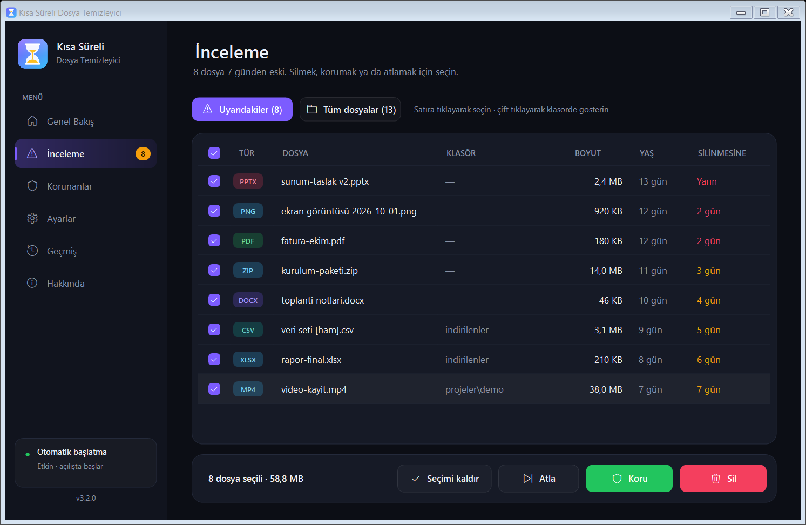
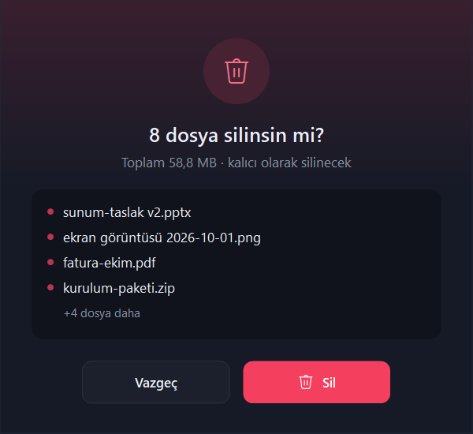
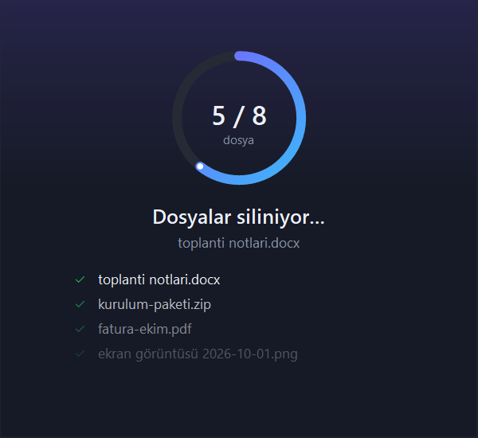
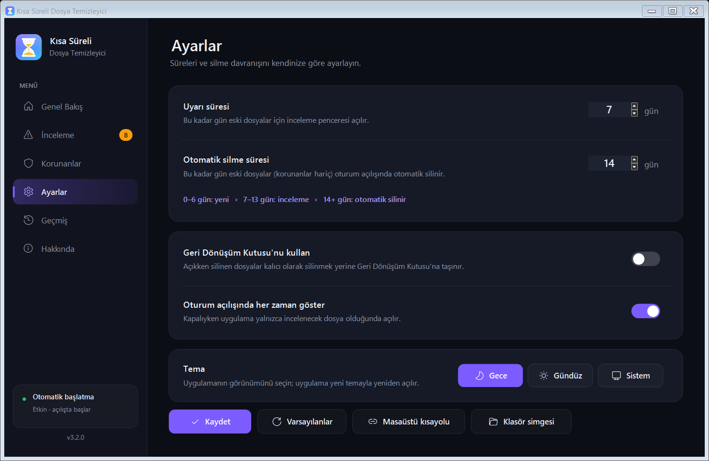
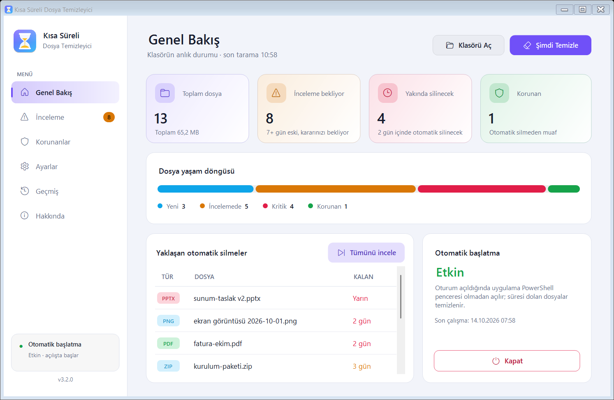
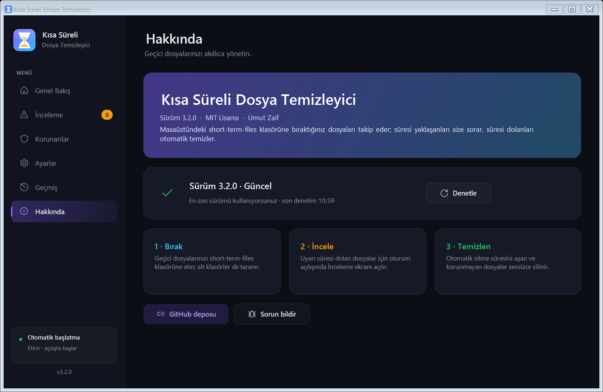

<div align="center">


# Kısa Süreli Dosya Temizleyici

**Masaüstündeki geçici dosyalarınızı unutun. Süresi yaklaşanları size sorar, süresi dolanları kendisi temizler.**

[](https://www.microsoft.com/windows)
[](../.system/CHANGELOG.md)
[](../.system/LICENSE)

</div>



---

## 🚀 Kurulum (3 adım, teknik bilgi gerekmez)

1. **İndirin:** Bu sayfanın üstündeki yeşil **Code** düğmesi → **Download ZIP**.
2. **Açın:** ZIP dosyasına sağ tıklayın → **Tümünü ayıkla**.
3. **Çalıştırın:** Çıkan klasördeki **`Dosya Temizleyici.exe`** dosyasına çift tıklayın ve kurulum penceresinde **Kur**'a basın.

Kurulum penceresi şunları sizin için yapar (hepsi varsayılan olarak açıktır):

| Seçenek | Ne yapar? |
|---------|-----------|
| **Oturum açılışında başlat** | Bilgisayar her açıldığında uygulama açılır ve süresi dolan dosyaları temizler |
| **Masaüstüne kısayol ekle** | Uygulamayı masaüstünden tek tıkla açarsınız |
| **Klasöre özel simge ver** | `short-term-files` klasörü masaüstünde saat simgesiyle kolayca fark edilir |

Uygulama kendini **Masaüstü › short-term-files** klasörüne kurar. Geçici dosyalarınızı bu klasöre atmanız yeterli.

> **"Windows kişisel bilgisayarınızı korudu" uyarısı görürseniz:** Bu, internetten indirilen ve dijital imzası olmayan uygulamalar için çıkan standart bir uyarıdır. **Ek bilgi → Yine de çalıştır**'a tıklayın. Uygulamanın tüm kaynak kodu bu depoda açıktır.

---

## 🧭 Nasıl çalışır?

| Dosya yaşı | Ne olur? |
|-----------|----------|
| 0-6 gün | Hiçbir şey; dosya yeni |
| 7-13 gün | Uygulama açılışta size sorar: **Sil**, **Koru** ya da **Atla** |
| 14+ gün | Korunmuyorsa otomatik olarak silinir |

Süreleri **Ayarlar** sayfasından değiştirebilirsiniz. Dosya yaşı, dosyanın oluşturulma ve değiştirilme tarihlerinden yenisine göre hesaplanır. Böylece klasöre kopyaladığınız eski bir dosya hemen silinmez.

### İnceleme ekranı
Oturum açıldığında incelenecek dosya varsa uygulama bu sayfayla açılır. Soldaki menüden diğer tüm sayfalara geçebilirsiniz.




| Onay | İlerleme | Sonuç |
|:---:|:---:|:---:|
|  |  |  |

### Ayarlar ve tema
Uyarı ve otomatik silme süreleri, Geri Dönüşüm Kutusu seçeneği, açılış davranışı, masaüstü kısayolu, klasör simgesi ve **tema**. Tema seçenekleri: **Gece**, **Gündüz** ya da Windows'un renk ayarını izleyen **Sistem**.



| Gündüz teması |
|:---:|
|  |

---

## 🔄 Güncellemeler

Yeni bir sürüm çıktığında uygulamayı silip yeniden indirmeniz **gerekmez**:

1. Uygulama her açıldığında GitHub'daki son sürümü arka planda denetler.
2. Yeni sürüm varsa **Genel Bakış**'ta yeşil bir **Güncelle** düğmesi belirir. Hakkında sayfasında da sürüm notları görünür.
3. Düğmeye basınca yeni sürüm indirilir, yerine kurulur ve uygulama kendini yeniden başlatır.

Ayarlarınız, korunan dosya listeniz, işlem geçmişiniz ve klasördeki dosyalarınız korunur. Kurulum sırasında bir sorun olursa önceki sürüm otomatik olarak geri yüklenir. Güncelseniz Hakkında sayfasında **"Sürüm x.x.x · Güncel"** yazar.



> **3.1.0 veya daha eski bir sürüm kullanıyorsanız:** Bu sürümlerde güncelleyici yok. Bir kereliğine yeni sürümü indirip `Dosya Temizleyici.exe`'yi çalıştırın; ayarlarınız korunarak kurulur. Sonraki sürümler otomatik gelir.


---

## ✨ Özellikler

- **Tek tıkla açılan uygulama:** `Dosya Temizleyici.exe`, PowerShell penceresi açılmadan çalışır
- **Kurulum sihirbazı:** Otomatik başlatma, masaüstü kısayolu ve klasör simgesi varsayılan olarak açık
- **Akıllı iki aşamalı temizlik:** Önce sorar, sonra temizler
- **Dosya koruma:** Önemli dosyalarınızı kalıcı olarak koruyun
- **Geri Dönüşüm Kutusu desteği:** İsterseniz dosyalar kalıcı silinmek yerine Geri Dönüşüm Kutusu'na gider
- **Korunan sistem dosyaları:** Uygulamanın kendi dosyaları gizli `.system` klasöründedir. Listelerde görünmez, silinemez ve korumaları değiştirilemez
- **Tema seçimi:** Gece, Gündüz veya Windows ayarını izleyen Sistem teması
- **Uygulama içi güncelleme:** Yeni sürüm tek tıkla kurulur, ayarlar ve dosyalar korunur
- **İşlem geçmişi:** Yapılan her silme ve koruma işlemi kaydedilir

---

## 🗂️ Klasör yapısı

```
Masaüstü\short-term-files\
├── Dosya Temizleyici.exe      ← uygulama (çift tıklayın)
├── (sizin geçici dosyalarınız ve klasörleriniz)
│
└── .system\                   ← gizli sistem klasörü; uygulamanın tüm dosyaları burada
    ├── MainApp.ps1 · Core.ps1 · UiKit.cs · App.cs
    ├── assets\                (uygulama ve klasör simgeleri)
    ├── build\                 (geliştirici derleme betiği)
    ├── config.json · protected-files.json · cleanup.log
    └── CHANGELOG.md · LICENSE
```

---

## 🐛 Sorun giderme

| Sorun | Çözüm |
|-------|-------|
| "Windows kişisel bilgisayarınızı korudu" uyarısı | **Ek bilgi → Yine de çalıştır** |
| Klasör simgesi değişmedi | Masaüstünde boş bir yere sağ tıklayıp **Yenile**'ye basın veya **Ayarlar → Klasör simgesi** |
| Bir dosya silinmedi | Başka bir programda açık olabilir. Ayrıntılar **Geçmiş** sayfasında |
| Açılışta her gün açılmasın | **Ayarlar → Oturum açılışında her zaman göster** seçeneğini kapatın; uygulama yalnızca incelenecek dosya olduğunda açılır |
| Otomatik başlatmayı kaldırmak | **Genel Bakış → Otomatik başlatma → Kapat** |
| Güncelleme denetlenemedi | İnternet bağlantınızı kontrol edip **Hakkında → Denetle**'ye basın |
| Uygulama açılmıyor | `.system\error.log` dosyasına bakın ve bir [sorun bildirin](https://github.com/umutzaif/short-term-file-cleaner/issues) |

---

## 🛠️ Geliştiriciler için

Uygulama Windows PowerShell 5.1 ve Windows Forms ile yazılmıştır. `Dosya Temizleyici.exe` küçük bir C# programıdır (`.system\App.cs`). PowerShell motorunu kendi süreci içinde barındırıp `.system\MainApp.ps1`'i çalıştırır. Ayrı bir `powershell.exe` başlatılmadığı için konsol penceresi oluşmaz, görev çubuğunda ve Görev Yöneticisi'nde uygulamanın kendi adı ve simgesi görünür.

```powershell
# Simgeleri üret ve exe'yi yeniden derle (.NET Framework'ün csc.exe'si kullanılır)
powershell -ExecutionPolicy Bypass -File .system\build\Build.ps1

# Komut satırı kurulum / kaldırma
powershell -ExecutionPolicy Bypass -File .system\Install.ps1
powershell -ExecutionPolicy Bypass -File .system\Uninstall.ps1
```

| Komut | Açıklama |
|-------|----------|
| `Dosya Temizleyici.exe` | Uygulamayı açar (ilk açılışta kurulum sihirbazı) |
| `Dosya Temizleyici.exe /startup` | Oturum açılışı modu: süresi dolanları siler, uygulamayı açar |
| `Dosya Temizleyici.exe /setup:autostart,desktop,foldericon` | Kurulum adımlarını doğrudan uygular |

Sürüm geçmişi: [.system/CHANGELOG.md](../.system/CHANGELOG.md)

---

## 📝 Lisans

MIT. Ayrıntılar için [.system/LICENSE](../.system/LICENSE).

<div align="center">

Made with ❤️ by [Umut Zaif](https://github.com/umutzaif)

</div>
