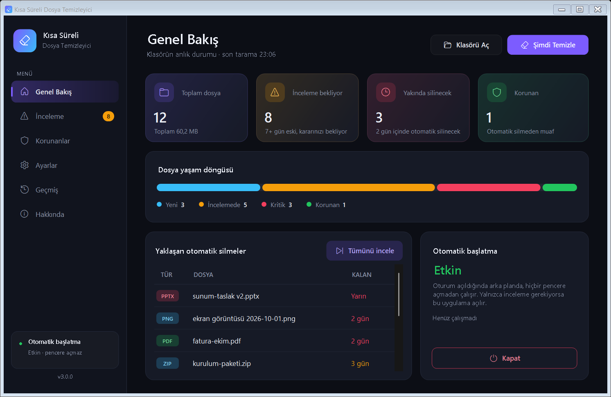
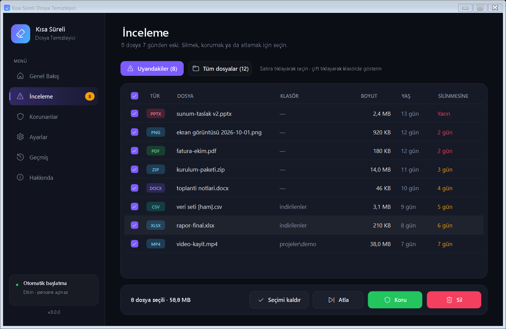
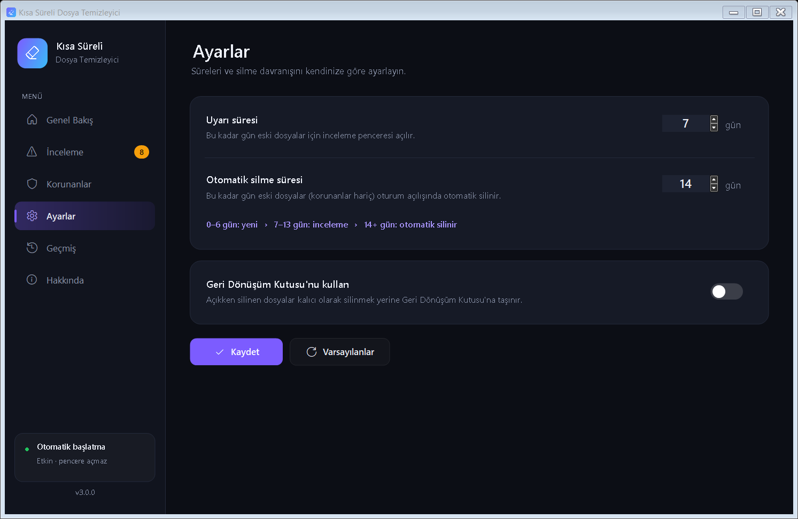

# 🗂️ Kısa Süreli Dosya Temizleyici

> Geçici dosyalarınızı otomatik olarak yönetin - Akıllı, kolay, güçlü

[](https://www.microsoft.com/windows)
[](https://docs.microsoft.com/powershell/)
[](LICENSE)
[](CHANGELOG.md)

Masaüstünüzde biriken geçici dosyalardan kurtulun! Bu uygulama `Desktop\short-term-files` klasörüne bıraktığınız dosyaları takip eder; süresi yaklaşanları size sorar, süresi dolanları otomatik olarak temizler. Kod yazmaya gerek yok, sadece kurulum yapın ve kullanmaya başlayın.



---

## ✨ Özellikler

### 🎯 Temel Özellikler
- **Sessiz Otomatik Başlatma**: Oturum açıldığında arka planda, **hiçbir PowerShell penceresi açmadan** çalışır
- **Akıllı İki Aşamalı Sistem**: Önce inceleme, sonra otomatik silme
- **Dosya Koruma**: Önemli dosyalarınızı kalıcı olarak koruyun
- **Geri Dönüşüm Kutusu Desteği**: İsterseniz dosyalar kalıcı silinmek yerine Geri Dönüşüm Kutusu'na gider
- **Boş Klasör Temizliği**: Dosyalarla birlikte boş klasörler de silinir
- **Sıfır Bağımlılık**: Sadece Windows yerleşik araçları kullanır

### 🖥️ Modern Arayüz (v3)
- **Koyu tema**, kenar çubuğu menüsü, istatistik kartları ve dosya yaşam döngüsü grafiği
- **Tek uygulama**: Açılışta çıkan inceleme ekranından Genel Bakış, Korunanlar, Ayarlar ve Geçmiş'e doğrudan geçilebilir
- **Dosya türü rozetleri**, kalan gün göstergesi, satıra tıklayarak seçim, çift tıklayarak klasörde gösterme
- **Yüksek DPI desteği**: %125 / %150 ölçeklemede net görüntü
- **Başlat menüsü kısayolu** ile uygulamaya her zaman ulaşın

---

## 📸 Ekran Görüntüleri

### İnceleme
Uyarı süresini geçen dosyaları seçin ve **Sil**, **Koru** ya da **Atla**. Oturum açılışında yalnızca incelenecek dosya varsa bu ekran açılır; soldaki menüden diğer tüm sayfalara geçebilirsiniz.



### Ayarlar
Uyarı ve otomatik silme sürelerini ayarlayın, Geri Dönüşüm Kutusu kullanımını açıp kapatın.



---

## 🚀 Hızlı Başlangıç

### Gereksinimler
- Windows 10/11
- Windows PowerShell 5.1 (yerleşik)

### Kurulum Adımları

#### 1️⃣ Projeyi İndirin
Masaüstünde `short-term-files` adıyla klonlayın (veya ZIP'i bu ada çıkartın):
```bash
cd %USERPROFILE%\Desktop
git clone https://github.com/umutzaif/short-term-file-cleaner.git short-term-files
```

#### 2️⃣ Ana Uygulamayı Çalıştırın
- `MainApp.ps1` dosyasına **sağ tıklayın** → **"Run with PowerShell"**

> **Not**: İlk çalıştırmada PowerShell execution policy uyarısı alabilirsiniz. Bu durumda:
> ```powershell
> Set-ExecutionPolicy -ExecutionPolicy RemoteSigned -Scope CurrentUser
> ```

#### 3️⃣ Otomatik Başlatmayı Kurun
- **Genel Bakış** sayfasındaki **Otomatik başlatma** kartında **"Otomatik başlatmayı kur"** butonuna tıklayın
- Sessiz başlatıcı (`Launcher.exe`) derlenir, oturum açılışı görevi ve Başlat menüsü kısayolu oluşturulur
- Bundan sonra uygulamayı **Başlat menüsü → Kısa Süreli Dosya Temizleyici** ile pencere olmadan açabilirsiniz ✅

#### 4️⃣ Kullanmaya Başlayın
- Geçici dosyalarınızı `Desktop\short-term-files` klasörüne atın
- İstediğiniz kadar alt klasör oluşturabilirsiniz
- Uygulama otomatik olarak yönetecek!

---

## 📖 Kullanım Kılavuzu

### İki Aşamalı Temizlik Sistemi

#### 📅 Varsayılan Ayarlar
- **Uyarı Süresi**: 7 gün
- **Otomatik Silme**: 14 gün

| Dosya Yaşı | Ne Olur? |
|-----------|----------|
| 0-6 gün | Hiçbir şey olmaz |
| 7-13 gün | Oturum açılışında İnceleme ekranı açılır (Sil / Koru / Atla) |
| 14+ gün | Oturum açılışında otomatik silinir (korunmadıysa) |

> **Dosya yaşı** nasıl hesaplanır? Dosyanın oluşturulma ve son değiştirilme tarihlerinden **yenisi** esas alınır. Böylece klasöre kopyaladığınız eski bir dosya hemen "süresi dolmuş" sayılıp silinmez.

### İnceleme Ekranı

| Buton | Ne Yapar? |
|-------|-----------|
| 🗑️ **Sil** | Seçili dosyaları onay sonrası siler (ayara göre kalıcı ya da Geri Dönüşüm Kutusu'na) |
| 🛡️ **Koru** | Seçili dosyaları kalıcı korumaya alır; otomatik silinmezler |
| ⏭️ **Atla** | Şimdilik hiçbir şey yapmaz; dosyalar sonraki açılışta tekrar sorulur |
| ✔️ **Tümünü seç** | Tüm satırları seçer / seçimi kaldırır (başlıktaki onay kutusu da aynı işi yapar) |

- **Uyarıdakiler / Tüm dosyalar** sekmeleriyle yalnızca inceleme bekleyenleri ya da klasördeki tüm dosyaları görebilirsiniz
- Bir satıra **çift tıklayarak** dosyayı Gezgin'de gösterebilirsiniz

### Sayfalar

| Sayfa | İçerik |
|-------|--------|
| **Genel Bakış** | Toplam / inceleme bekleyen / yakında silinecek / korunan dosya sayıları, yaşam döngüsü grafiği, yaklaşan silmeler, otomatik başlatma durumu, **Şimdi Temizle** ve **Klasörü Aç** |
| **İnceleme** | Sil / Koru / Atla ekranı |
| **Korunanlar** | Korunan dosyalar; **Dosya Ekle**, **Korumayı Kaldır**, **Eksikleri Temizle** |
| **Ayarlar** | Uyarı ve otomatik silme süreleri, Geri Dönüşüm Kutusu seçeneği |
| **Geçmiş** | Renklendirilmiş işlem günlüğü |
| **Hakkında** | Sürüm, nasıl çalışır, GitHub bağlantıları |

---

## ⚙️ Gelişmiş Yapılandırma

### Manuel (config.json)
```json
{
  "warningDays": 7,
  "deletionDays": 14,
  "useRecycleBin": false,
  "lastModified": "2026-10-13T20:00:00+03:00"
}
```

Dosya konumu: `Desktop\short-term-files\.system\config.json`

### Komut satırı
```powershell
# Paneli açar
.\MainApp.ps1

# Oturum açılışı modunu elle çalıştırır (süresi dolanları siler, gerekiyorsa İnceleme'yi açar)
.\MainApp.ps1 -Startup

# Otomatik başlatmayı kur / kaldır
.\.system\Install.ps1
.\.system\Uninstall.ps1
```

---

## 🗂️ Klasör Yapısı

```
Desktop\short-term-files\
│
├── MainApp.ps1              # 🎯 ANA UYGULAMA
├── README.md / LICENSE / CHANGELOG.md
├── screenshots\             # README görselleri
│
├── .system\                 # ⚙️ Sistem klasörü (taramaya dahil edilmez)
│   ├── Core.ps1                    # Ortak çekirdek: tarama, silme, koruma, görev kurulumu
│   ├── UiKit.cs                    # Modern arayüz kontrolleri (ilk açılışta derlenir)
│   ├── Launcher.cs                 # Sessiz başlatıcı kaynağı → Launcher.exe
│   ├── ShortTermFileCleaner.ps1    # Eski görev tanımları için uyumluluk girişi
│   ├── Install.ps1 / Uninstall.ps1 # Komut satırından kurulum / kaldırma
│   ├── config.json                 # Yapılandırma
│   ├── protected-files.json        # Korunan dosyalar
│   └── cleanup.log                 # İşlem geçmişi
│
└── [Kullanıcı Dosyaları]    # 📁 Geçici dosyalarınızı buraya atın
```

---

## 🔧 Teknik Detaylar

| Özellik | Detay |
|---------|-------|
| **Dil** | PowerShell 5.1 + C# (çalışma anında derlenen UI kiti) |
| **GUI** | Windows Forms, özel çizimli koyu tema, DWM koyu başlık çubuğu |
| **Zamanlama** | Windows Görev Zamanlayıcı (oturum açılışı + 20 sn gecikme) |
| **Sessiz başlatma** | `Launcher.exe` PowerShell'i `CREATE_NO_WINDOW` ile başlatır; konsol penceresi oluşmaz |
| **Tarama** | Recursive; gizli/sistem öğeleri ve bağlantı noktaları (junction) atlanır |
| **Hariç tutulan** | `.system`, `.git`, kökteki uygulama dosyaları, tüm `.ps1` ve `README.md` dosyaları |
| **Encoding** | UTF-8 |

### Çalışma Prensibi

1. **Başlangıç**: Oturum açıldığında Görev Zamanlayıcı `Launcher.exe /startup` komutunu çalıştırır
2. **Otomatik silme**: Otomatik silme süresini aşan, korunmayan dosyalar silinir
3. **Kontrol**: Uyarı süresini aşan dosya yoksa uygulama hiçbir pencere açmadan kapanır
4. **İnceleme**: Varsa uygulama İnceleme sayfasıyla açılır; diğer sayfalara menüden geçilebilir
5. **Temizlik**: Boş kalan klasörler silinir, tüm işlemler log'a yazılır

---

## 🐛 Sorun Giderme

| Sorun | Çözüm |
|-------|-------|
| MainApp açılmıyor | PowerShell execution policy ayarlayın (yukarıya bakın) |
| Açılışta PowerShell penceresi görünüyor | Genel Bakış → Otomatik başlatma kartında **Sessiz moda güncelle**'ye tıklayın |
| "Erişim engellendi" hatası | Eski görev yönetici olarak oluşturulmuş olabilir; butona tıklayınca tek seferlik yönetici onayı istenir |
| Dosyalar silinmiyor | **Geçmiş** sayfasındaki "Silme hatasi" satırlarını kontrol edin (dosya başka bir programda açık olabilir) |
| İnceleme ekranı açılmıyor | Dosya yaşlarını **İnceleme → Tüm dosyalar** sekmesinden kontrol edin |

---

## 🤝 Katkıda Bulunma

1. Fork edin
2. Feature branch oluşturun (`git checkout -b feature/harika-ozellik`)
3. Commit edin (`git commit -m 'Harika özellik eklendi'`)
4. Push edin (`git push origin feature/harika-ozellik`)
5. Pull Request açın

### Geliştirme Fikirleri
- [ ] Farklı klasörler için farklı süreler
- [ ] Dosya türüne göre filtreleme
- [ ] İstatistik ve raporlama
- [ ] Sistem tepsisi ikonu

---

## 📝 Lisans

Bu proje MIT lisansı altında lisanslanmıştır. Detaylar için [LICENSE](LICENSE) dosyasına bakın.

---

## 📞 İletişim

- **GitHub**: [@umutzaif](https://github.com/umutzaif)
- **Issues**: [Sorun bildirin](https://github.com/umutzaif/short-term-file-cleaner/issues)

---

## 📊 Sürüm Geçmişi

Ayrıntılar için [CHANGELOG.md](CHANGELOG.md).

- **v3.0.0** — Yeni koyu tema arayüz, sessiz başlatma, Sil butonu düzeltmesi, birleşik uygulama
- **v2.0.0** — Ana GUI uygulaması, yapılandırma ve koruma sistemi
- **v1.0.0** — İlk sürüm

---

<div align="center">

**Geçici dosyalarınızı akıllıca yönetin! 🚀**

Made with ❤️ by [Umut Zaif](https://github.com/umutzaif)

</div>
